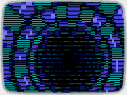
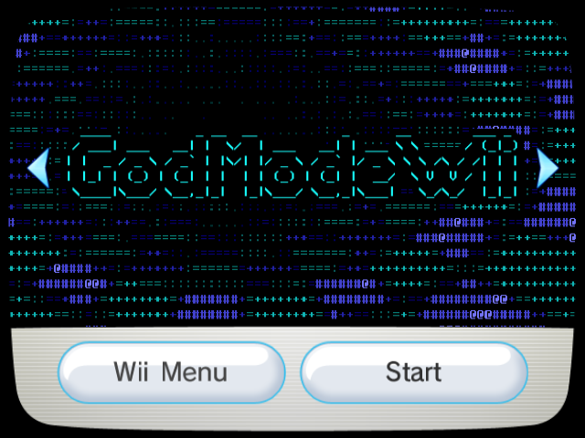
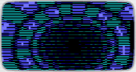
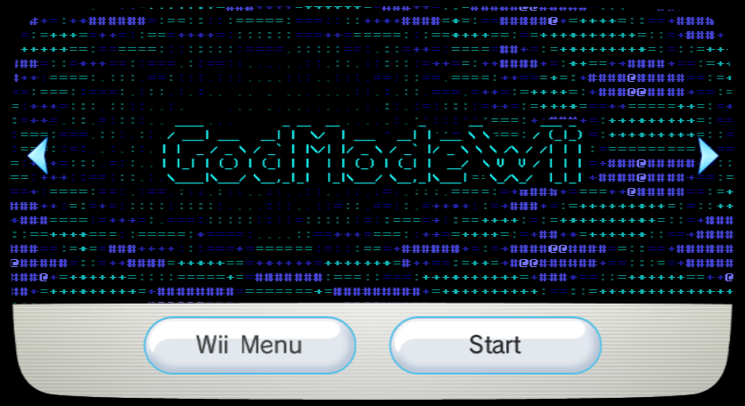

# GodModeWii Forwarder Channel

A Wii channel that boots straight into [**GodModeWii**](https://github.com/quatric/GodModeWii), a GodMode9-style file manager for the Wii and the Wii U's vWii mode.

## Screenshots

<table>
  <thead>
    <tr>
      <th width="50%">4:3 Icon</th>
      <th width="50%">4:3 Banner</th>
    </tr>
  </thead>
  <tbody>
    <tr>
      <td></td>
      <td></td>
    </tr>
  </tbody>
</table>

<table>
  <thead>
    <tr>
      <th width="50%">16:9 Icon</th>
      <th width="50%">16:9 Banner</th>
    </tr>
  </thead>
  <tbody>
    <tr>
      <td></td>
      <td></td>
    </tr>
  </tbody>
</table>

## Requirements

- **IOS58** — on an original Wii, update to System Menu 4.3, or use the [IOS58 Installer](https://wiibrew.org/wiki/IOS58_Installer). Wii U's vWii already has its own IOS58; don't use the Wii installer there.
- **GodModeWii installed to `apps/GodModeWii/boot.dol`** on SD or USB.

| Title ID | Region | NAND Blocks |
|---|---|---|
| GMWA (00010001474D5741) | Free | 6 (Wii), 6 (vWii) |

## Read this first: exiting back to the Homebrew Channel

**Exit to loader** in GodModeWii's HOME menu reaches the Homebrew Channel from this channel in GodModeWii 0.9.0 and later. If you're still running 0.8.0 or earlier, choosing it after starting GodModeWii from this channel will either send you to the Wii Menu or cause a black screen forcing you to perform a system reset.

GodModeWii can also change your NAND, which can brick a console. Read the brick risk warning at the top of [its README](https://github.com/quatric/GodModeWii#readme) before you use it.

## Install

> **Install BootMii and/or Priiloader first.** I took time to make sure that this `.wad` is safe, but one should always have protections in place in case of a banner brick.

1. Download the `.zip` for your console from the releases page and extract the `.wad` inside.
2. Install using the WAD manager of your choice.
3. Ensure GodModeWii is installed to `apps/GodModeWii/boot.dol` on SD or USB — that exact folder name.

## Uninstall

- Use the WAD manager you used to install the channel to uninstall it, or, delete it from the Wii system settings.

## Repository contents

| path | |
|---|---|
| `audio/` | source for the banner sound, and its loop point |
| `banner/` | one finished banner frame, and the outlined logo |
| `build/` | the Python toolchain that rebuilds everything |
| `forwarder/` | source for the forwarder, which shows GodModeWii's logo as its loading screen |
| `icon/` | GodModeWii's Homebrew Channel icon (the source of the icon lettering), and one finished icon frame |
| `layout/` | the banner and icon layouts and animations from the built WAD, with their Benzin XML |
| `preview/` | the icon animation as GIFs and the banner as stills, captured on the real Wii Menu |
| `splash/` | a render of the forwarder's loading screen |
| `BUILDING.md` | how to rebuild, and what was changed in the GPL'd components |

The banner archive still carries 31 four-by-four stub textures, 24 of them named after Mario, Bowser, Princess and Toad, and the icon's carries 9, six of them named after Mario and a Goomba. They are never drawn, and they are there on purpose: every `txl1` entry in Tantric's layouts has to still resolve.

## Credits

### App forwarded to

- [**GodModeWii**](https://github.com/quatric/GodModeWii) by **quatric** & **cmyksoda**, a text-mode file manager in the style of [GodMode9](https://github.com/d0k3/GodMode9) by **d0k3**.
- The splash lettering and the Homebrew Channel icon lettering are GodModeWii's.

### Channel base

**FCE Ultra GX Channel** — donor for the banner and icon archives.

- **wilsoff**: coding
- **MrNick666**: artwork
- **Tantric**: forwarder and installer
- **svpe** and **megazig**: installer exploit

The banner and icon layouts are Tantric's, edited rather than rebuilt: every section the System Menu expects is still where it was. Their animations are new. All of it is documented in [BUILDING.md](BUILDING.md).

**USB Loader GX forwarder** — donor for the ticket and TMD, which already ask for IOS58 and the hardware access a forwarder needs.

- **The USB Loader GX team**

**The Homebrew Channel** by **Team Twiizers / fail0verflow** — the forwarder starts apps the way it does.

**vWii NAND loader** — boots the forwarder in the vWii build.

- **FIX94**, megazig, the TinyLoad authors and dimok: [vWii NAND loader](https://github.com/FIX94/tiny-vwii-nand-loader)

### Graphics and sound

- The banner and icon composites are my own work.
- The banner's tunnel is a port of **Texture Tunnel** from [ascii-magic-art](https://github.com/kailashsr38/ascii-magic-art) by **ASCII Magic**, recolored and redrawn in libogc's console font. The banner stores a small map of characters per frame and has the Wii's graphics chip draw them, using indirect texturing.
- The banner's tunnel characters, its splash lettering and the icon's drive list use libogc's 8×16 console font, the one GodModeWii draws with.
- The banner sound is **kebab** by **Jallabert** (2006), retrieved from lsd.nu: pattern 1 once, then pattern 2 on repeat.

### Tools used

- **Benzin 2.1.12BETA** by **SquidMan (Alex Marshall)**, **comex** and **megazig**, © 2009 HACKERCHANNEL, for `brlyt`/`brlan` XML round-trips
- **libopenmpt**, which rendered the banner sound from the module
- **devkitPPC** / **libogc**, for building the forwarder
- **Dolphin**, for testing on the real Wii Menu
- Everything else is in `build/tools/`: a from-scratch Python implementation of the WAD container, U8, LZ77, IMD5/IMET, TPL and a DSP ADPCM encoder, carried over from my [Z-GX channel](https://github.com/cmyksoda/z-gx-forwarder-channel) along with its layout and animation XML editors, plus new code for the tunnel and its tile-mode material.

## License

The parts of this repository that are mine — the build toolchain in `build/`, the forwarder in `forwarder/`, the channel art, and the documentation — are free software under the [GNU General Public License, version 3 or later](LICENSE).

This channel is built out of other people's work, which stays under the licenses it came with:

- the banner archive and icon are derived from [FCE Ultra GX](https://github.com/dborth/fceugx), which is GPL
- the vWii build's NAND loader is [FIX94's](https://github.com/FIX94/tiny-vwii-nand-loader), under GPL version 2; its license is also included in the vWii ZIP's `LICENSE`
- the tunnel animation is ported from [ascii-magic-art](https://github.com/kailashsr38/ascii-magic-art), under the MIT license; its notice is in `build/tools/tunnel.LICENSE`
- the console font is libogc's, under the zlib license; its notice is in `build/tools/console_font_8x16.LICENSE`
- the app it launches, [GodModeWii](https://github.com/quatric/GodModeWii), is GPL version 2 and is **not** redistributed here

The banner music is used for a non-commercial fan project and is not covered by any of the above; it remains the property of its author.

---

*This project was made with AI assistance. For more information, see [my AI usage statement](https://github.com/cmyksoda/cmyksoda/blob/main/AI_USAGE.md).*
